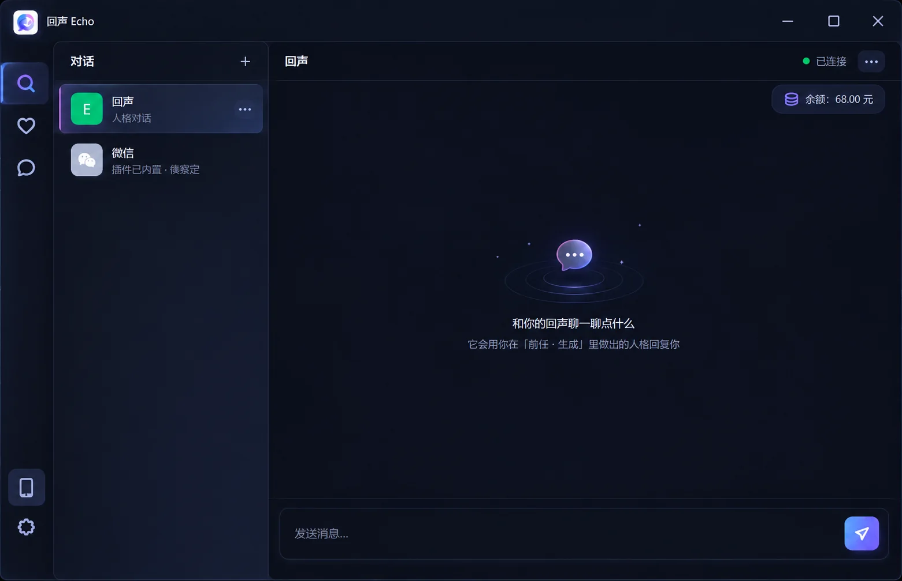
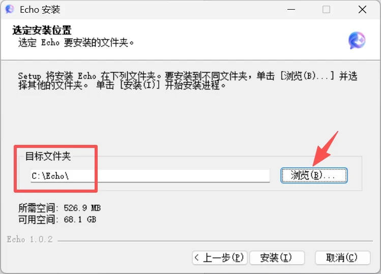
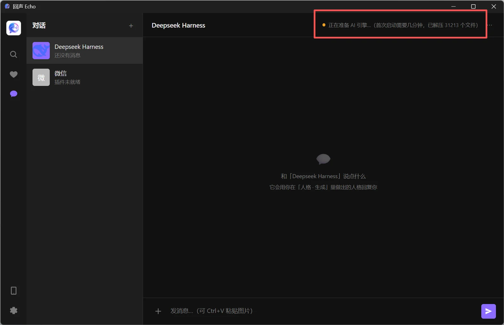
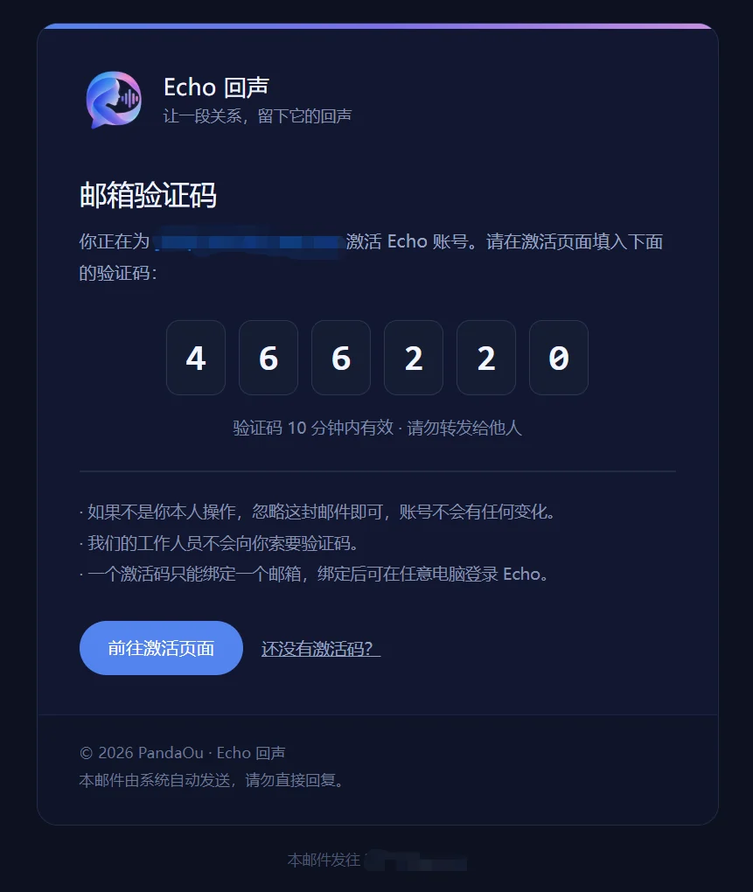
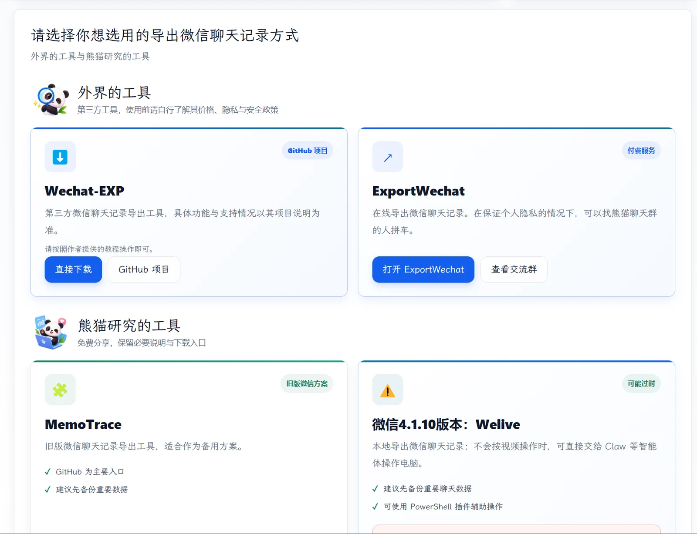
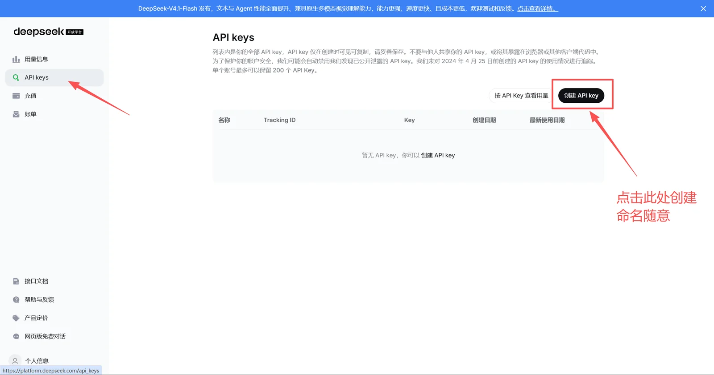
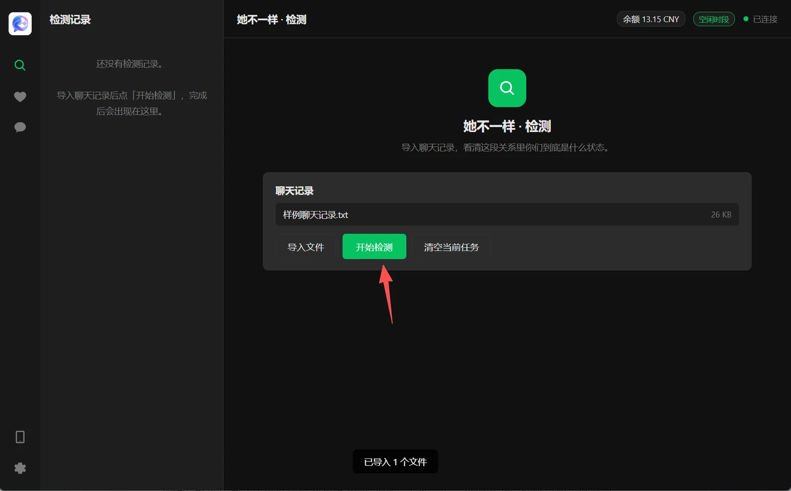
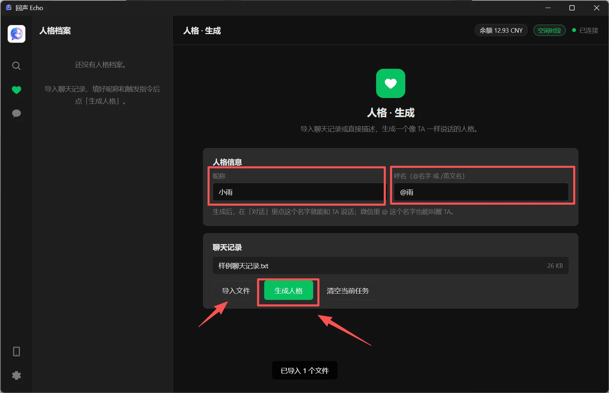
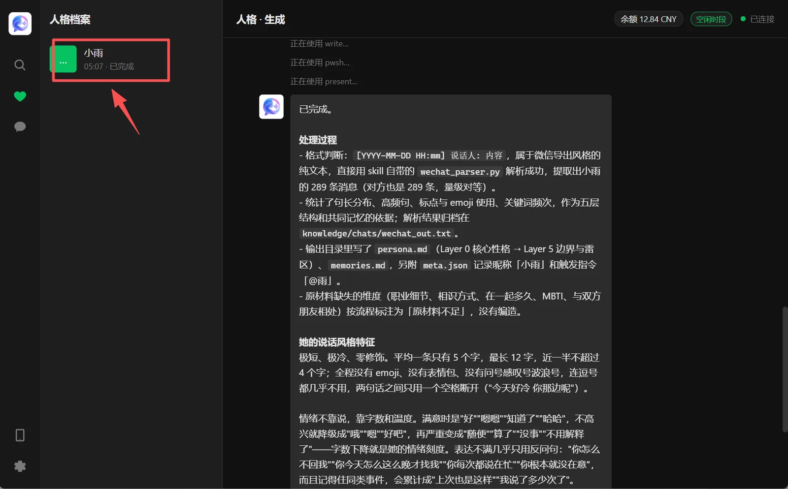
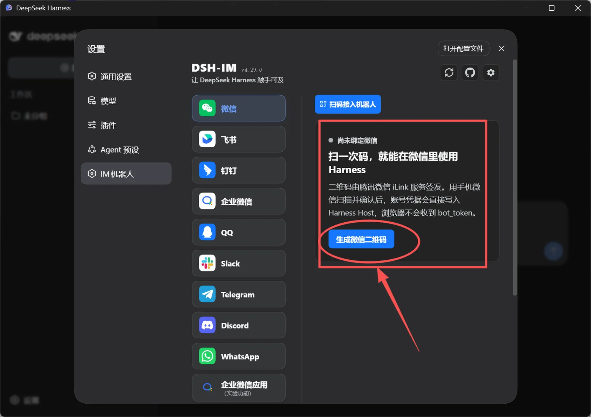

<div align="center">


# Echo 回声

**把一段关系，留下它的回声。**

从聊天记录里，提取她的语言习惯与情感特征，借助 DeepSeek 生成只属于你的「数字人格」。
那些熟悉的语气、习惯和温度，都将在这里重新响起。

<sub>当前版本 v1.0.1 · 仅支持 Windows 10 / 11</sub>

[官网](https://pandaou.cloud/echo) · [下载](https://github.com/PandaOu233/-Echo/releases) · [购买激活码](https://www.kufaka.com/shop/PandaOu) · [使用教程](https://pandaou.cloud/echo/tutorial/)

</div>

---



## 这是什么

一个跑在你电脑上的 AI 伴侣工具。

你把和某个人的聊天记录导进去，Echo 会读出她的说话方式——用什么词、怎么断句、什么话题会冷淡、什么话说出来是在示弱——然后把这些凝成一份可以对话的「人格」。

对话由 **DeepSeek** 驱动，用的是你自己的 API Key，花的也是你自己的钱。聊天记录不上传，我们不保存、不查看、也不拿去训练。

## 它能做什么

| 功能 | 说明 |
|---|---|
| **她不一样 · 情感分析报告** | 从你们的对话里，读懂她情绪起伏的规律与变化。 |
| **人格蒸馏** | 基于 DeepSeek 提取语言风格与情绪倾向，凝成一份只属于她的人格。 |
| **模拟对话** | 直接开始聊。回复的语气、用词和停顿，都来自你导入的那段关系。 |
| **本地处理 · 隐私安全** | 记录只在你的电脑上处理，服务器只负责校验激活码。 |

## 不用配环境

很多 AI 工具第一次用要先装 Python、Node.js、一堆依赖，再慢慢解决报错。Echo 不用。

| Echo 已经准备好 | 你需要做什么 |
|---|---|
| Echo 主程序 | 直接打开 |
| DSH AI 引擎 | 自动准备 |
| Python 运行环境 | 不用安装 |
| 所需依赖与 Skill | 已经打包 |
| 必要补丁 | 已经配置 |

你只需要：**下载 → 解压 → 打开 → 配置 DeepSeek → 开始使用**

第一次启动会把内置的 AI 运行环境解压到你的电脑，这个过程只做一次，之后占用 1 GB 左右。多占一点空间，换来的是开箱即用。

## 下载与安装

到 [Releases](https://github.com/PandaOu233/-Echo/releases) 下载最新版安装包，或者在[官网](https://pandaou.cloud/echo)点「下载 Echo」。

1. **双击安装包**，按提示安装。建议装到 C 盘（默认就是 `C:\Echo`）。
2. 等待 3–5 分钟。
3. 安装完成后运行 Echo，进入登录界面。



第一次运行需要准备 AI 引擎，右上角会显示进度。变成「启动中」或「已连接」就绪。



## 激活

Echo 需要一枚激活码。到[熊猫的店铺](https://www.kufaka.com/shop/PandaOu)购买，付款后你会拿到一串这样的卡密：

```
ECHO-XXXX-XXXX-XXXX-XXXX-XXXX
```

然后打开 [激活页面](https://pandaou.cloud/echo/activate/)：

1. 填入你的邮箱，点「发送验证码」。
2. 去邮箱里取 6 位验证码填进来。
3. 填上激活码，点「激活账号」。



激活成功后，用这个邮箱在客户端登录即可。

> 一枚激活码绑定一个邮箱，激活后永久可用，没有有效期。
> 换电脑：在新电脑上装好 Echo，用同一个邮箱登录，不需要重新购买。
> 需要换邮箱的话请联系我们——换邮箱要重新购买。

## 使用方法

### 1. 把聊天记录带回来

用我们的[聊天记录提取工具](https://pandaou.cloud/vx/)把记录导出成 txt。

实测下来 **Wechat-EXP** 效果最好，下面的步骤以它为例。这类工具需要读取微信的本地文件、破解密钥，容易被杀毒软件误杀——弹窗拦截时先关掉杀毒软件再操作（这一点你自己判断，我们只是说明有这种可能）。



### 2. 让 Echo 接入 AI

Echo 的对话能力来自 DeepSeek，需要你自己的 API Key。

1. 打开 [DeepSeek 开放平台](https://platform.deepseek.com/)，注册或登录。
2. 充值。调用费按实际用的 token 算，高峰时段（工作日 9:00–12:00、14:00–18:00）按标准价，其余时间半价——夜里、午休、周末、法定节假日都算空闲时段。
3. 在「API Keys」页面创建一个 Key。**它只在创建时显示一次，请立刻复制保存。**
4. 回到 Echo 填入这个 Key，点「开始使用」。



配置好之后，你在 Echo 里随时能看到 DeepSeek 账号余额。

> 建议先小额充值试用，确认模型效果和成本符合预期再补。

### 3. 情感分析报告

左侧栏第一个选项。导入要分析的聊天记录，点「开始检测」，等它跑完，点方格看报告（会用默认浏览器打开）。这一步是附加功能，不是必须的。



### 4. 人格蒸馏

左侧栏第二个选项。选好要蒸馏的人和对应的聊天记录，点「生成人格」。
记录越长，需要的时间越久。跑完之后，这个人格的特点和记忆就都提取到你电脑本地了。



> 想让 Echo 正常聊天，这一步必须先做。

### 5. 开始对话

在「人格档案」里点进去，或者直接在对话栏里找她。

聊天界面右上角三个点可以改头像、昵称、选模型和思考强度。不同模型和思考强度，消耗的 token 不一样（只有部分模型支持识图，识图更费）。



### 6. 绑定微信（可选）

Echo 支持连到微信上的 ClawBot，在手机微信里直接聊。

对话期间 Echo 必须开着——可以点「×」把它最小化到托盘。进「设置 → IM 机器人」，点生成二维码，用手机微信扫一下就行。



## 常见问题

**我的聊天记录会被上传吗？**
不会。解析和人格生成都在你电脑本地完成，服务器只负责校验激活码。我们不保存、不查看、不用于训练。AI 对话要联网——那是你自己在调 DeepSeek 的 API。

**作者服务器停了，Echo 还能用吗？**
分两种情况。本地功能（人格蒸馏、本地对话、情感分析报告）不受影响，照常能用。网页激活和邮箱验证会受影响——换电脑、重装系统要重新激活时，激活页面可能打不开，验证码也发不出去。因服务器停止维护导致联网功能不可用的，软件不退款，但可以联系我，我尽量提供离线激活方案。

**DSH 以后更新了，Echo 会失效吗？**
不会。Echo 内置的 DSH 内核是版本冻结的打包快照，不联网自动更新，也不依赖 DSH 官方后续版本。你解压的那一刻，内核、Node 运行时、Python 环境、所有插件和技能就都固定了。

**微信连接会中断吗？**
有可能会。微信连接依赖 iLink 官方通道，这条通道的可用性不在我们控制范围内——如果腾讯调整政策或限制接入，连接可能中断。所有第三方微信机器人都面临这个不确定性，不是 Echo 独有的问题。中断不影响本地对话功能，也不构成退款理由。

**激活码可以给别人用吗？**
激活码绑定邮箱，用过了就只能在你绑定的邮箱下使用。换邮箱需要重新购买。

**买错了能退款吗？**
虚拟商品一经激活，原则上不支持退款。没激活的可以到[申请退款](https://pandaou.cloud/echo/refund/)页提交，我们会核对订单。

**提示「激活码无效」/「邮箱已被绑定」怎么办？**
先检查激活码有没有复制错（前后有没有多空格），再确认它是不是已经绑过别的邮箱。「邮箱已被绑定」说明这个邮箱之前已经激活过 Echo。确认无误还是不行，发邮件给我。

## 关于

Echo 由 **PandaOu** 制作。把复杂的环境准备好，让你打开就能用——希望更多人能更方便地用上新科技带来的技术升级。

- 官网：<https://pandaou.cloud/echo>
- 下载：<https://github.com/PandaOu233/-Echo/releases>
- 购买激活码：<https://www.kufaka.com/shop/PandaOu>
- 使用教程：<https://pandaou.cloud/echo/tutorial/>
- 建议反馈：<https://pandaou.cloud/echo/feedback/>
- 意见与问题：panda_ou@qq.com

<sub>本 README 由 echo-site 的教程文档生成，教程更新后重跑 <code>build/github-export.py</code> 即可同步。</sub>
